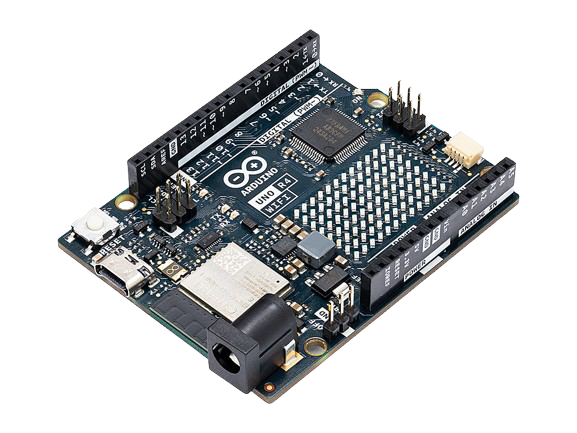
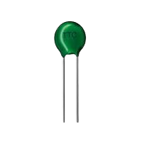
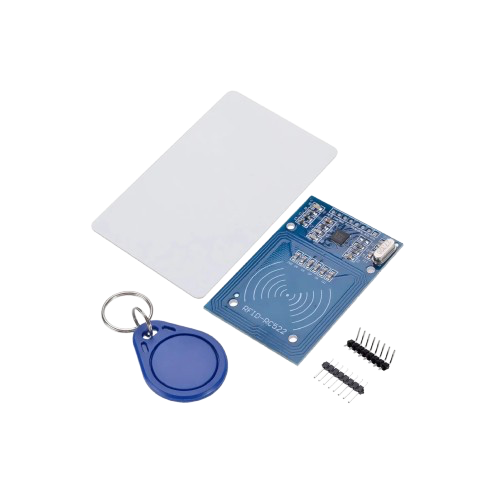

# Physical Computing Project 2026 - IT KMITL

### Project
โครงงานระบบเช็กชื่อเข้าเรียนด้วยบัตร RFID พร้อมบันทึกอุณหภูมิร่างกาย เป็นการพัฒนาระบบเช็กชื่ออัตโนมัติโดยใช้บอร์ด Arduino ร่วมกับโมดูล RFID RC522 สำหรับอ่านรหัส UID จากบัตรนักศึกษา และเซนเซอร์ Thermistor สำหรับตรวจวัดอุณหภูมิร่างกาย พร้อมบันทึกข้อมูลเวลาเข้าเรียนและส่งข้อมูลผ่านเครือข่าย Wi-Fi ไปยังเว็บแอปพลิเคชัน เพื่อแสดงผลข้อมูลแบบเรียลไทม์ ผู้สอนสามารถตรวจสอบสถานะการเข้าเรียนและการมาสาย รวมถึงดาวน์โหลดข้อมูลสรุปในรูปแบบไฟล์ CSV ได้อย่างสะดวก โดยมีไฟ LED บนอุปกรณ์สำหรับแสดงสถานะการทำงานของระบบ

---

### Objective
* เพื่อพัฒนาระบบเช็กชื่อเข้าเรียนอัตโนมัติด้วยเทคโนโลยี RFID ช่วยลดเวลาในการเช็กชื่อของผู้สอน
* เพื่อบันทึกข้อมูล UID ของนักศึกษา อุณหภูมิร่างกาย และเวลาเข้าเรียนอย่างเป็นระบบ
* เพื่อแสดงข้อมูลการเข้าเรียนแบบเรียลไทม์ผ่านเว็บแอปพลิเคชัน
* เพื่อเพิ่มความสะดวกในการสรุปและส่งออกข้อมูลการเข้าเรียนในรูปแบบไฟล์ CSV สำหรับนำไปใช้งานต่อ

---

### Contributer
| Student ID | Name | Duty |
| --- | --- | --- |
| 68070230 | เจติยา อิ่นแก้ว | Arduino Wi-Fi & Web Server |
| 68070243 | ญาณิศา สุริยเดชวงค์ | Hardware |
| 68070264 | ธนัญญา อัศวสงคราม | Arduino Sensor & LED |
| 68070276 | นริสรา เตชะวัชรเทพ | Web |

---

## Tools
| Arduino Uno R4 | Thermistor | RFID RC522 |
| --- | --- | --- |
|  |  |  |

## Web github.io
https://68070264.github.io/Ma-rian-laew-jaa/

## Demo Video
https://youtu.be/eA89S1MFqkc

## Poster

## Source
- https://www.cybertice.com/article/116/สอนใช้งาน-arduino-เชื่อมต่อ-rfid-module-อ่านบัตรคีย์การ์ด-ควบคุมเปิดปิดไฟ-led?gad_source=1&gad_campaignid=23053428197&gbraid=0AAAAADc4pmMJUiAuvXsPqvIjfNA5iWGg2&gclid=CjwKCAjw9PvWBhAxEiwAddzYyUTssQho-eIBCGa1ISMZdcZ5H3MPDI5-zR2_by28KJpbAkzy4lCtnBoC8XYQAvD_BwE
- https://youtu.be/cYUylJyeuS8?si=w_vcRV0S7T0vdUK3
- https://www.ab.in.th/article/72/สอนใช้งานโมดูล-rfid-rc522-ร่วมกับ-arduino-อ่านการ์ดและแท็กแบบง่ายๆ-อัพเดท-2026?srsltid=AYCX9vIRDawMx-MR-JPGN5z-nhhoqxMb_dSSCvj57CXuZZcYAIQL-a3z

